# Ticket Breakdown — Sports Tools Hub: HTML site → Docusaurus

Source: `architecture.md` (accepted direction, 2026-11-11)
Epic type: brownfield migration into a greenfield Docusaurus codebase
Target: this repo (`sportstools/`, Docusaurus 3.10.2 scaffold)
Legacy source: `C:\Users\user\Documents\Production\sport_tools` (read-only)

## Epic summary

Move 258+ live, indexed pages — home, about, 41 client-side calculators, blog index, and 214 articles
across 14 sports — onto Docusaurus without losing organic search position or visual/behavioral parity.
The end state is one catalog driving nav/footer/home/search, calculator formulas as pure tested TypeScript,
content as MDX, and legacy `.html` URLs preserved by a build-time alias layer. Every slice is judged by:
**no SEO regression → visual/behavioral parity → maintainable end state.**

## Slicing conventions

- Each ticket is one testable concern, a vertical slice, sized for a single PIV loop
  (~8–10 subtasks, roughly 400–1500 changed lines including tests). Generated-content tickets are
  larger in file count but mechanical and reviewed by a scripted checklist.
- Context references use the architecture headings plus the exact source artifacts. A fresh loop should
  be able to start at `/piv-plan-implementation` without re-reading the whole epic.
- "Source" means read-only input under `C:\Users\user\Documents\Production\sport_tools`; never modify it.
- The five spikes in the architecture are folded into the tickets that need them:
  Spike 1 → ST-3/ST-28 · Spike 2 → ST-6 · Spike 3 → ST-15 · Spike 4 → ST-26 · Spike 5 → ST-28.
- Tool page path assumption: standalone MDX pages at `src/pages/tools/<slug>.mdx` (no docs sidebar).
  ST-1 confirms pages-vs-docs; if a docs instance is chosen, the path becomes `docs/tools/<slug>.mdx`
  and `routeBasePath: '/tools'`.
- Blog path: `blog/<sport>/<slug>.mdx` with `slug: <sport>/<slug>`, so the route is `/blog/<sport>/<slug>/`.

## Decisions to settle before execution (architecture § Open questions)

These block or shape specific tickets. Defaults below follow the architecture recommendation; record the
answer in the ticket before planning it.

| # | Decision | Default | Affects |
| --- | --- | --- | --- |
| D1 | 5 dead blog links + missing `golf-equipment-guide.html`: write, drop, or redirect to sport tag | Drop dead cards; do not invent the missing article; log in cutover notes | ST-3, ST-15–ST-22 |
| D2 | Aliases carry `noindex` in addition to canonical? | Canonical only (no `noindex`) | ST-3 |
| D3 | Dark mode in v1? | Disabled, light-only | ST-1, ST-2 |
| D4 | Carry `pruneseo-site-verification` meta tag? | Drop unless confirmed for the sports domain | ST-1 |
| D5 | Authored reading times vs derived | Derived by the blog plugin | ST-15 |
| D6 | Future-dated posts (2026) order/pagination | Keep source dates as-is | ST-15–ST-22 |
| D7 | Stubbed `trackToolUsage` hooks | Drop (no-op, no analytics plan) | ST-15 |
| D8 | Remaining 3 images + favicon set; is `images/hero-1.jpg` used? | Audit against source `index.html`; port all referenced assets | ST-25 |
| D9 | Local search plugin vs generated JSON fallback | Try plugin in ST-26; fall back to JSON index + existing custom search | ST-26 |

## Tickets

### Foundation and contracts

#### ST-1 — Foundation, toolchain, and site configuration

- **Scope / acceptance criteria:** Configure the Docusaurus app for Sports Tools Hub and make the baseline
  build trustworthy. Site title/url/tagline/favicon, `organizationName`/`projectName`, light-only
  `colorMode`, remove template docs/blog/pages (tutorial content, sample authors/tags, default images),
  disable the template docs sidebar, set `onBrokenLinks: 'throw'`, keep `trailingSlash` unset with the
  proven comment from `pruneseo`, and add scripts/dependencies: `vitest` (`test`, `test:run`),
  `lucide-react`, `@fontsource/inter`, and the search candidate if adopted. Remove the Google Fonts
  `<link>` expectation from the build path. `npm run build`, `npm run typecheck`, and `npm run test:run`
  pass on the empty shell. No dark toggle, no tutorial content, no example assets left referenced.
- **Per-ticket context:** Architecture § Key decisions — Stack & libraries, URL & routing strategy,
  Styling & design system, Build & deploy. Local convention: sibling `../pruneseo/docusaurus.config.ts`
  (stack and `trailingSlash` note). Source `index.html` for title/tagline/meta (ignore mojibake emoji;
  D4 applies).
- **Files touched (estimate):** `docusaurus.config.ts`, `package.json`, `tsconfig.json`, `sidebars.ts`,
  `src/pages/index.tsx` (placeholder), `src/css/custom.css`, delete template `blog/*`, `docs/*`,
  `src/components/HomepageFeatures/*`, default `static/img/*` not used by brand.
  Also `vitest.config.ts`, `src/test/setup.ts`.
- **Rough size:** ~400–700 lines (mostly config, deletions, dependency files).
- **Depends on:** none (entry ticket).

#### ST-2 — Brand CSS, typography, and scoped style foundation

- **Scope / acceptance criteria:** Establish brand tokens and global styling without leaking Infima styles
  into calculators. Self-host Inter via `@fontsource/inter` (remove runtime Google Fonts), map brand colors
  (`#3b82f6` primary), type scale, spacing, card/form/result tokens onto CSS variables in
  `src/css/custom.css`, and define the page-wrapper class convention for scoped tool/blog CSS Modules.
  Port the non-calculator shell styles needed by later theme tickets; do not port calculator internals yet
  (ST-5 owns those). Light-only palette. Acceptance: home placeholder, a bare MDX page, and a bare form
  render with correct fonts/colors; no external font request; no global rule changes form control sizes.
- **Per-ticket context:** Architecture § Styling & design system, § Key decisions — Stack & libraries.
  Source `styles.css` (24 KB), `tools.css` (15 KB), `blog/blog.css` (17 KB) — extract tokens and shell
  rules only, not page-specific duplication. Parity rule: same palette, Inter, card/form/result hierarchy.
- **Files touched (estimate):** `src/css/custom.css`, `src/css/tokens.css` (if split),
  `src/theme/Root.tsx` or `src/pages/_app` equivalent for font import, one demo wrapper component/CSS module,
  `package.json`.
- **Rough size:** ~700–1200 lines (tokens + ported shell CSS).
- **Depends on:** ST-1.

#### ST-3 — Legacy URL inventory and alias layer

- **Scope / acceptance criteria:** Create the SEO contract and the build-time redirect emitter.
  (1) Generate `src/data/legacy-urls.json` (old path → new route) from source `sitemap.xml` plus the page
  inventory; reconcile the 258-vs-259 discrepancy; apply known fixes (`/tools/about.html` → `/about.html`;
  missing `golf-equipment-guide.html` per D1; the 5 dead blog-link cases per D1). (2) A `postBuild` plugin
  reads the map and writes a physical `<old-path>.html` at each legacy path containing an instant
  meta-refresh, `<link rel="canonical">` to the clean route, and the new title; no `noindex` (D2). (3) The
  build fails if any legacy URL lacks a target or if a target route does not exist. Home and the blog index
  need no `/index.html` alias; `/blog/blog.html` and `/about.html` do. Acceptance: a fixture subset emits
  correct aliases; clean routes still resolve; alias files never appear in the sitemap; `legacy-urls.json`
  has complete, unique coverage.
- **Per-ticket context:** Architecture § URL & routing strategy, Missing pieces #1, Spike 1, Open questions
  (D1, D2). Source `sitemap.xml` (259 locs), `tools/` (41 files), `blog/` (214 posts + `blog.html`),
  `about.html`, `index.html`. Spike 1: prove `/tools/x.html`, `/tools/x`, `/tools/x/`, `/blog/sport/x.html`
  on a 3-page slice before scaling.
- **Files touched (estimate):** `plugins/legacy-aliases/index.ts`, `src/data/legacy-urls.json`,
  `src/data/legacy-urls.test.ts` (or `scripts/verify-legacy-urls.mjs`), fixture pages, `docusaurus.config.ts`.
- **Rough size:** ~600–900 lines (plugin + generated map + tests).
- **Depends on:** ST-1 (config/plugin hook). Can run in parallel with ST-2/ST-4.

#### ST-4 — Tool catalog and icon mapping

- **Scope / acceptance criteria:** One typed catalog in `src/data/tools.ts` with 41 entries:
  `slug`, `title`, `description`, `category` (`fitness` | `performance` | `nutrition`), `legacyPath`,
  `icon` (lucide name), `component` (registry key). Extract titles/descriptions/categories from
  `index.html` and each tool page; replace corrupted emoji with a deliberate lucide mapping. Export helpers
  for category grouping, lookup by slug, related tools, and legacy target. Validate with a test: 41 unique
  slugs, every `legacyPath` matches ST-3's contract, every lucide name is a real import, every category is
  in the union. This ticket also records the footer duplication fix (one "Performance Trackers" heading) as
  catalog structure, not markup. No hand-maintained card lists anywhere.
- **Per-ticket context:** Architecture § Data model — Tool, Missing pieces #2 and #8, Styling & design
  system (icons). Source `index.html` (three category sections, card titles/descriptions/links) and each
  `tools/*.html` `<h1>`/meta description. ST-3 owns `legacy-urls.json`; this catalog must agree with it.
- **Files touched (estimate):** `src/data/tools.ts`, `src/data/tools.test.ts`, `src/data/icons.ts` (if split).
- **Rough size:** ~500–800 lines (41 entries + types + tests).
- **Depends on:** ST-1. Parallel with ST-2/ST-3.

#### ST-5 — Calculator kit

- **Scope / acceptance criteria:** Build the shared primitives every calculator uses, with no formulas:
  `NumberField`, `UnitField` (kg/lbs, cm/ft-in), `ChoiceField`, `ResultCard`, `ResultRow`, `ShareButton`,
  `PrintButton`, and `useCalculator` (typed state, validation, scroll-to-results, share/print behavior).
  Components are presentational, accessible, and styled via CSS Modules scoped under the page wrapper;
  no DOM globals, no network, no persistence beyond theme preference. Include unit tests for validation and
  unit conversion helpers, and a demo harness proving each primitive renders and round-trips values.
  Acceptance: a sample form computes a trivial pure function end-to-end; keyboard labels are correct;
  share/print do not leak health data; no Infima bleed.
- **Per-ticket context:** Architecture § Calculator architecture (kit list, parity rules), § Styling &
  design system (scoped CSS Modules), § Boundaries & contracts (privacy). Source `tools.css` for form/result
  layout, `script.js` for shared behaviors (validation, scroll, share/print — reuse behavior, not the
  92 KB blob), and one simple source tool (`bmi-calculator.html`) as a shape reference.
- **Files touched (estimate):** `src/components/calculators/kit/*` (7 components + hook + CSS modules),
  `src/lib/calculators/units.ts`, tests, a dev-only demo page.
- **Rough size:** ~1000–1400 lines.
- **Depends on:** ST-2.

#### ST-6 — Calculator parity proof (3 archetypes)

- **Scope / acceptance criteria:** Execute Spike 2 and lock the port pattern before scaling.
  Port `bmi-calculator` (single form, unit toggles), `body-fat-calculator` (multi-method, 27 KB inline JS),
  and `body-type-quiz` (stateful quiz driven by shared JS): pure typed formula modules, kit-based components,
  and MDX pages with the source SEO prose. Capture golden inputs/outputs **from the live/source pages before**
  extracting logic; Vitest cases must match values, rounding, category thresholds/text, validation bounds and
  messages, and scroll/share/print behavior. Each tool's `/tools/<slug>/` route and `/tools/<slug>.html`
  alias must resolve. Record the conventions the remaining 38 tools will follow (float rounding, unit
  edge cases, messaging) in the ticket/implementation notes. Acceptance: all three match exactly; if
  systemic mismatches appear, fix them in ST-5 and re-run before ST-7.
- **Per-ticket context:** Architecture § Calculator architecture, Spike 2, Missing pieces #4. Source
  `tools/bmi-calculator.html`, `tools/body-fat-calculator.html`, `tools/body-type-quiz.html`,
  `script.js`, `tools.css`. Depends on ST-4 catalog entries (bmi, body-fat, body-type-quiz) and ST-5 kit;
  aliases from ST-3.
- **Files touched (estimate):** 3 × `src/lib/calculators/<tool>.ts` + tests,
  3 × `src/components/calculators/<Tool>.tsx` (+ CSS module if needed),
  3 × `src/pages/tools/<slug>.mdx`, small kit adjustments from findings.
- **Rough size:** ~1200–1600 lines.
- **Depends on:** ST-3, ST-4, ST-5.

### Calculator ports (remaining 38, in 8 batches)

Each batch: per tool, a pure formula module with golden tests, a kit-based React component, an MDX page with
extracted SEO prose, the catalog entry already present (ST-4), and a working legacy alias (ST-3). All batch
tickets are independent of each other; they only share the frozen kit/pattern from ST-5/ST-6. Acceptance for
every tool: `/tools/<slug>/` and `/tools/<slug>.html` resolve; computed values/rounding/thresholds/messages
match the source; no network or persistence; `npm run build`, `typecheck`, and `test:run` pass.

#### ST-7 — Fitness batch A

- **Tools (5):** `one-rep-max-calculator`, `calorie-calculator`, `heart-rate-calculator`,
  `lean-body-mass-calculator`, `yoga-calorie-calculator`.
- **Per-ticket context:** Architecture § Calculator architecture + Spike 2 conventions; source
  `tools/<slug>.html` + `script.js`; ST-5 kit, ST-6 pattern. Extract prose from each source body
  (description, "About X", considerations, limitations); keep the calculator as an island.
- **Files:** 5 formula modules + tests, 5 components, 5 MDX pages.
- **Rough size:** ~1200–1600 lines. **Depends on:** ST-6.

#### ST-8 — Fitness batch B

- **Tools (5):** `golf-handicap-calculator`, `injury-risk-calculator`, `pace-calculator`,
  `running-calorie-calculator`, `vo2max-calculator`.
- **Per-ticket context:** Same as ST-7. `injury-risk-calculator` has a large inline script (58 KB page) —
  capture its thresholds and category wording carefully; `pace-calculator` shares pace/unit logic with
  later performance tools, so keep conversions in `src/lib/calculators/units.ts` rather than duplicating.
- **Files:** 5 × (formula + test + component + MDX).
- **Rough size:** ~1200–1600 lines. **Depends on:** ST-6.

#### ST-9 — Performance batch A (endurance/cycling)

- **Tools (5):** `cycling-power`, `swim-pace`, `stride-length-cadence-calculator`,
  `cycling-gear-ratio-calculator`, `swimming-stroke-efficiency-calculator`.
- **Per-ticket context:** Same as ST-7; these are performance trackers with bespoke result shapes
  (architecture explicitly rejects a universal engine). Reuse `UnitField`/`ResultRow` where honest, let odd
  result blocks stay custom. Preserve any charts/tables as presentational-only, no chart library.
- **Files:** 5 × (formula + test + component + MDX).
- **Rough size:** ~1300–1700 lines. **Depends on:** ST-6.

#### ST-10 — Performance batch B (sport load)

- **Tools (5):** `basketball-vertical-jump-analyzer`, `soccer-match-load-calculator`,
  `cricket-bowling-workload-tracker`, `tennis-match-energy-expenditure-tool`,
  `badminton-rally-intensity-calculator`.
- **Per-ticket context:** Same as ST-7. These are sport-specific trackers; keep sport names/units in the
  formula module's typed inputs, not in copy conditionals. Ensure the shared validation messages are reused
  unless the source deliberately differs.
- **Files:** 5 × (formula + test + component + MDX).
- **Rough size:** ~1300–1700 lines. **Depends on:** ST-6.

#### ST-11 — Performance batch C (planning/environment)

- **Tools (5):** `training-load-calculator`, `race-strategy-planner`, `heat-acclimatization-calculator`,
  `altitude-adjustment-calculator`, `combat-sports-weight-class-optimizer`.
- **Per-ticket context:** Same as ST-7. `race-strategy-planner` and `combat-sports-weight-class-optimizer`
  are planners/optimizers with multi-step or result-table UIs; keep the optimizer logic pure and testable,
  and do not force it through a generic schema. `heat-acclimatization`/`altitude-adjustment` share
  environmental-adjustment conventions — extract shared helpers only if the math truly matches.
- **Files:** 5 × (formula + test + component + MDX).
- **Rough size:** ~1400–1800 lines. **Depends on:** ST-6.

#### ST-12 — Nutrition batch A (core macros)

- **Tools (5):** `protein-calculator`, `tdee-calculator`, `hydration-calculator`, `macro-calculator`,
  `bmr-calculator`.
- **Per-ticket context:** Same as ST-7. These share activity-factor and body-metric inputs; put shared
  typed helpers in the lib layer with their own tests, but keep each tool's formula module explicit.
  Preserve category thresholds and rounding exactly.
- **Files:** 5 × (formula + test + component + MDX).
- **Rough size:** ~1100–1500 lines. **Depends on:** ST-6.

#### ST-13 — Nutrition batch B (meal guidance)

- **Tools (5):** `meal-timing`, `micronutrient-checker`, `glycemic-load-calculator`,
  `pre-workout-nutrition`, `post-workout-recovery`.
- **Per-ticket context:** Same as ST-7. These are guidance tools with richer result prose; MDX owns the
  educational copy, the component owns only computed recommendations. Keep all health inputs client-only.
- **Files:** 5 × (formula + test + component + MDX).
- **Rough size:** ~1200–1600 lines. **Depends on:** ST-6.

#### ST-14 — Nutrition batch C (planners)

- **Tools (3):** `intermittent-fasting-planner`, `refeed-day-calculator`, `weight-cut-gain-planner`.
- **Per-ticket context:** Same as ST-7. These are multi-step planners with the most bespoke result shapes;
  three is deliberate sizing. Validate the full planner flow (state transitions, unit toggles, result
  summary) and preserve any timing tables as presentational markup.
- **Files:** 3 × (formula + test + component + MDX).
- **Rough size:** ~1000–1400 lines. **Depends on:** ST-6.

### Blog conversion

#### ST-15 — Blog pipeline + 6-post spike

- **Scope / acceptance criteria:** Execute Spike 3 and build the reusable converter. Extract
  `title`, `description`, `date`, `tag`/sport from `blog/blog.html` cards; convert source HTML bodies to MDX
  (strip duplicated navbar/footer, keep the logo-only `` out of content, rewrite absolute
  `sportstoolshub.com` links to internal routes, preserve headings/lists/links, handle tables); create
  `blog/authors.yml` (Sports Tools Hub) and `blog/tags.yml` (14 sport tags + topic tags). Convert 6 posts
  spanning 2 sports, including one of the 2 posts with tables. Blog plugin configured for
  `slug: <sport>/<slug>`, reading time per D5, dates as-is per D6, no `trackToolUsage` (D7). Acceptance:
  all 6 build at `/blog/<sport>/<slug>/`; tag pages list them; RSS/atom include them; legacy aliases resolve;
  the script is idempotent and documented; decision rule recorded (if <95% render cleanly, switch to a
  per-post review cadence for the batch tickets).
- **Per-ticket context:** Architecture § Data model — Blog post, Missing pieces #5, Spike 3, Open questions
  (D1, D5, D6, D7). Source `blog/blog.html` (card metadata), `blog/<sport>/*.html` (214 posts), `blog/blog.css`.
  Aliases from ST-3; blog shell styles from ST-2.
- **Files touched (estimate):** `scripts/convert-blog.mjs` (+ README notes), `blog/authors.yml`,
  `blog/tags.yml`, 6 × `blog/<sport>/<slug>.mdx`, `docusaurus.config.ts` blog options, tests for the
  metadata/link-rewrite helpers.
- **Rough size:** ~900–1300 lines (pipeline + 6 posts).
- **Depends on:** ST-1, ST-2, ST-3.

#### ST-16 — Blog batch: basketball + soccer

- **Scope / acceptance criteria:** Run the ST-15 pipeline over the remaining basketball and soccer posts
  (28 total minus any ST-15 picks), review and fix conversion artifacts, and verify routes, aliases, tags,
  and RSS. These are two of the most visible sports; spot-check cross-links between related articles and
  tool pages. Exclude any post already converted by ST-15.
- **Per-ticket context:** ST-15 pipeline + recorded decision rule; Architecture § Data model — Blog post,
  Missing pieces #5. Source `blog/basketball/*.html`, `blog/soccer/*.html`; metadata from `blog/blog.html`;
  aliases from ST-3.
- **Files touched:** ~25–28 × `blog/<sport>/<slug>.mdx`; occasional `tags.yml`/`authors.yml` fixes.
- **Rough size:** generated content ~3000–5000 lines, reviewed by the ST-15 checklist.
- **Depends on:** ST-15.

#### ST-17 — Blog batch: cycling + cricket

- **Scope / acceptance criteria:** Same as ST-16 for cycling and cricket (31 total minus ST-15 picks).
  If the table-containing post falls here, verify tables render (GFM) and match source cell content.
- **Per-ticket context:** ST-15 pipeline; source `blog/cycling/*.html`, `blog/cricket/*.html`;
  `blog/blog.html` metadata; ST-3 aliases.
- **Files touched:** ~28–31 × `blog/<sport>/<slug>.mdx`.
- **Rough size:** generated content ~3000–5000 lines.
- **Depends on:** ST-15.

#### ST-18 — Blog batch: tennis + golf

- **Scope / acceptance criteria:** Same as ST-16 for tennis and golf (30 posts). Golf includes the D1
  resolution for the missing `golf-equipment-guide.html`: drop the dead card/link and do not invent the
  article unless the product owner decides otherwise. Verify the golf tag page and sitemap counts reflect
  the decision.
- **Per-ticket context:** ST-15 pipeline; Architecture § Open questions (D1), Missing pieces #11; source
  `blog/tennis/*.html`, `blog/golf/*.html`; ST-3 aliases.
- **Files touched:** ~30 × `blog/<sport>/<slug>.mdx`; maybe `blog/blog.html`-derived index exclusions.
- **Rough size:** generated content ~3000–5000 lines.
- **Depends on:** ST-15.

#### ST-19 — Blog batch: boxing + karate

- **Scope / acceptance criteria:** Same as ST-16 for boxing and karate (31 posts). These are combat-sport
  guides; check that related-tool links point at the combat/weight-class and training-load tools.
- **Per-ticket context:** ST-15 pipeline; source `blog/boxing/*.html`, `blog/karate/*.html`; ST-3 aliases.
- **Files touched:** ~31 × `blog/<sport>/<slug>.mdx`.
- **Rough size:** generated content ~3000–5000 lines.
- **Depends on:** ST-15.

#### ST-20 — Blog batch: wrestling + hockey

- **Scope / acceptance criteria:** Same as ST-16 for wrestling and hockey (31 posts). Verify any tables,
  numbered drill lists, and equipment sections convert cleanly.
- **Per-ticket context:** ST-15 pipeline; source `blog/wrestling/*.html`, `blog/hockey/*.html`; ST-3 aliases.
- **Files touched:** ~31 × `blog/<sport>/<slug>.mdx`.
- **Rough size:** generated content ~3000–5000 lines.
- **Depends on:** ST-15.

#### ST-21 — Blog batch: pickleball + squash

- **Scope / acceptance criteria:** Same as ST-16 for pickleball and squash (32 posts, the largest batch).
  Keep it mechanical; if the batch exceeds the review budget, split into two PRs within the same ticket
  without changing scope.
- **Per-ticket context:** ST-15 pipeline; source `blog/pickleball/*.html`, `blog/squash/*.html`;
  ST-3 aliases.
- **Files touched:** ~32 × `blog/<sport>/<slug>.mdx`.
- **Rough size:** generated content ~3000–5000 lines.
- **Depends on:** ST-15.

#### ST-22 — Blog batch: table-tennis + swimming

- **Scope / acceptance criteria:** Same as ST-16 for table-tennis and swimming (31 posts). Verify the
  table-tennis metadata already present in `blog/blog.html` (it is the first sport in the index) maps to
  correct slugs and descriptions.
- **Per-ticket context:** ST-15 pipeline; source `blog/table-tennis/*.html`, `blog/swimming/*.html`;
  `blog/blog.html` metadata; ST-3 aliases.
- **Files touched:** ~31 × `blog/<sport>/<slug>.mdx`.
- **Rough size:** generated content ~3000–5000 lines.
- **Depends on:** ST-15.

### Theme, pages, and assets

#### ST-23 — Navbar and footer from the catalog

- **Scope / acceptance criteria:** Replace template chrome with Docusaurus theme components (swizzle or
  `src/theme/Navbar`, `src/theme/Footer`) fed by `src/data/tools.ts`. Navbar: Home/Tools/Blog/About with the
  brand logo; footer columns by category with **one** "Performance Trackers" heading (fixes the duplicate),
  no hand-maintained tool links. Preserve the source look within the accepted chrome differences
  (architecture Spike 5 accepts nav/footer differences). Acceptance: adding/removing a catalog entry changes
  nav/footer without markup edits; all footer links build clean under `onBrokenLinks: 'throw'`; mobile menu
  matches source behavior; light-only.
- **Per-ticket context:** Architecture § Styling & design system, § Data model — Tool, Missing pieces #6 and
  #11. Source `index.html` nav/footer (note the repeated heading), `styles.css` nav/footer rules. Depends on
  ST-4 and ST-2.
- **Files touched (estimate):** `src/theme/Navbar/*`, `src/theme/Footer/*`, CSS modules,
  maybe `src/components/ToolLink/*`.
- **Rough size:** ~600–900 lines. **Depends on:** ST-2, ST-4.

#### ST-24 — Home page (hero, search UI, catalog grid)

- **Scope / acceptance criteria:** Rebuild `/` as a React page: hero from source, search input in the same
  visual position (functionality wired in ST-26, stub is acceptable here), and tool grid grouped by category
  from the catalog with lucide icons, titles, descriptions, and links. Match card layout/hierarchy, not the
  mojibake emoji. Acceptance: all 41 tools appear once in the correct category; links resolve to
  `/tools/<slug>/`; responsive at desktop/mobile; no template content; visual parity signed off per Spike 5
  (home).
- **Per-ticket context:** Architecture § Recommended approach (Home), § Data model — Tool, Missing pieces
  #6. Source `index.html` (hero, category sections, cards), `styles.css`. Depends on ST-4 and ST-2.
- **Files touched (estimate):** `src/pages/index.tsx`, `src/pages/index.module.css`,
  `src/components/ToolGrid/*`, `src/components/ToolCard/*`, hero component (search UI placeholder).
- **Rough size:** ~700–1000 lines. **Depends on:** ST-2, ST-4.

#### ST-25 — About, 404, and static assets

- **Scope / acceptance criteria:** Port `/about/` as MDX from `about.html`; build a branded 404 page; move
  the real brand assets into `static/` (logo, hero, og image, favicon set, manifest if used), plus `CNAME`
  (`sportstoolshub.com`), `.nojekyll`, and `robots.txt` with the sitemap line pointing at the new sitemap.
  Audit the open image question (D8) and remove unused template images. Acceptance: `/about/` renders with
  source copy; `/about.html` alias resolves via ST-3; 404 renders with chrome; no 404s for referenced
  assets; no third-party font request.
- **Per-ticket context:** Architecture § Data model (static assets), § Build & deploy, Missing pieces #6,
  Open questions (D8). Source `about.html`, `index.html` (hero/logo/og references), `images/`, favicon set,
  `robots.txt`, `manifest.json`. Depends on ST-1/ST-2.
- **Files touched (estimate):** `src/pages/about.mdx`, `src/pages/404.tsx` (+ CSS), `static/*` assets,
  `static/CNAME`, `static/robots.txt`.
- **Rough size:** ~400–700 lines. **Depends on:** ST-1, ST-2.

#### ST-26 — Search integration

- **Scope / acceptance criteria:** Execute Spike 4: install `@easyops-cn/docusaurus-search-local` and prove
  it builds with Docusaurus 3.10.2 + React 19 while indexing 5 pages. If it works, configure it to index
  tools and blog; wire the home hero search to query the index scoped to tools, and add a blog search entry
  point. If it fails, generate a JSON index from the catalog + blog metadata and keep the existing client
  search logic. Acceptance: no runtime network calls; build-time index covers all tools and posts; home
  search returns scoped tool results; blog search returns posts; empty state is usable; decision recorded.
- **Per-ticket context:** Architecture § Search, Spike 4, Missing pieces #9, Open questions (D9). Depends on
  ST-4 (catalog), ST-15/ST-16+ (blog metadata present), ST-24 (home search UI).
- **Files touched (estimate):** `docusaurus.config.ts` (plugin), `src/components/Search/*`,
  `src/pages/index.tsx` wiring, `scripts/build-search-index.mjs` if fallback, tests for index shape.
- **Rough size:** ~600–900 lines. **Depends on:** ST-4, ST-15, ST-24.

### Delivery

#### ST-27 — GitHub Pages workflow and preview environment

- **Scope / acceptance criteria:** Update the GitHub Actions workflow from "upload the repo" to
  `npm ci` → `npm run build` → upload `build/` to Pages, Node 20+, dependency cache, and a preview target
  (branch deploy or artifact/PR preview) usable before DNS cutover. Keep `static/CNAME` and `.nojekyll`.
  Acceptance: workflow succeeds on a clean checkout; preview URL serves the build; production deploy is
  gated behind the cutover in ST-28; no secrets committed.
- **Per-ticket context:** Architecture § Build & deploy, § Boundaries & contracts, Missing pieces #10.
  Sibling `../pruneseo` workflow as local convention. Depends on ST-1.
- **Files touched (estimate):** `.github/workflows/*.yml`, maybe `README.md` run notes.
- **Rough size:** ~200–400 lines. **Depends on:** ST-1. Parallel with content work.

#### ST-28 — Full-site parity verification and cutover

- **Scope / acceptance criteria:** Execute Spike 1 at full scale and Spike 5 across representative pages.
  Build a scripted parity check over every legacy URL: HTTP status, title, canonical, `h1`, and that the
  destination is the intended new route; verify the generated sitemap against `legacy-urls.json` (every
  legacy URL resolves, every canonical page listed, no aliases present); verify `robots.txt`, `CNAME`, RSS,
  and tag pages. Visual diff home, BMI, one article, and the blog index at desktop/mobile widths; accept
  nav/footer chrome differences only. Produce a cutover runbook (preview verification → DNS/production
  switch → rollback path via `legacy-urls.json`/`_redirects` escape hatch). Acceptance: 100% URL/content
  parity, zero broken links, golden tests green, documented cutover sign-off.
- **Per-ticket context:** Architecture § Build & deploy, § Spikes 1 and 5, § Open questions, § Missing
  pieces #10–#11. Depends on all content/theme tickets.
- **Files touched (estimate):** `scripts/parity-check.mjs`, CI step, `docs/cutover-runbook.md`,
  parity fixtures/snapshots.
- **Rough size:** ~800–1200 lines. **Depends on:** ST-2–ST-27 (all content and theme work).

## Dependency graph

```mermaid
graph TD
  ST1[ST-1 Foundation]
  ST2[ST-2 Brand CSS]
  ST3[ST-3 Legacy URLs + aliases]
  ST4[ST-4 Tool catalog]
  ST5[ST-5 Calculator kit]
  ST6[ST-6 Parity proof: 3 archetypes]
  ST7[ST-7 Fitness A]
  ST8[ST-8 Fitness B]
  ST9[ST-9 Performance A]
  ST10[ST-10 Performance B]
  ST11[ST-11 Performance C]
  ST12[ST-12 Nutrition A]
  ST13[ST-13 Nutrition B]
  ST14[ST-14 Nutrition C]
  ST15[ST-15 Blog pipeline + spike]
  ST16[ST-16 Basketball+Soccer]
  ST17[ST-17 Cycling+Cricket]
  ST18[ST-18 Tennis+Golf]
  ST19[ST-19 Boxing+Karate]
  ST20[ST-20 Wrestling+Hockey]
  ST21[ST-21 Pickleball+Squash]
  ST22[ST-22 TableTennis+Swimming]
  ST23[ST-23 Navbar + footer]
  ST24[ST-24 Home page]
  ST25[ST-25 About + 404 + assets]
  ST26[ST-26 Search]
  ST27[ST-27 Deploy workflow]
  ST28[ST-28 Parity + cutover]

  ST1 --> ST2
  ST1 --> ST3
  ST1 --> ST4
  ST1 --> ST27
  ST2 --> ST5
  ST2 --> ST23
  ST2 --> ST24
  ST2 --> ST25
  ST3 --> ST6
  ST4 --> ST6
  ST5 --> ST6
  ST6 --> ST7
  ST6 --> ST8
  ST6 --> ST9
  ST6 --> ST10
  ST6 --> ST11
  ST6 --> ST12
  ST6 --> ST13
  ST6 --> ST14
  ST2 --> ST15
  ST3 --> ST15
  ST15 --> ST16
  ST15 --> ST17
  ST15 --> ST18
  ST15 --> ST19
  ST15 --> ST20
  ST15 --> ST21
  ST15 --> ST22
  ST4 --> ST23
  ST4 --> ST24
  ST4 --> ST26
  ST15 --> ST26
  ST24 --> ST26
  ST23 --> ST28
  ST24 --> ST28
  ST25 --> ST28
  ST26 --> ST28
  ST27 --> ST28
  ST7 --> ST28
  ST8 --> ST28
  ST9 --> ST28
  ST10 --> ST28
  ST11 --> ST28
  ST12 --> ST28
  ST13 --> ST28
  ST14 --> ST28
  ST16 --> ST28
  ST17 --> ST28
  ST18 --> ST28
  ST19 --> ST28
  ST20 --> ST28
  ST21 --> ST28
  ST22 --> ST28
```

## Suggested execution order

**Wave 1 — foundation (serial, blocking):**
- ST-1 Foundation, toolchain, and site configuration

**Wave 2 — contracts and independent foundations (parallel):**
- ST-2 Brand CSS and typography
- ST-3 Legacy URL inventory and alias layer
- ST-4 Tool catalog and icon mapping
- ST-27 GitHub Pages workflow and preview environment

**Wave 3 — prove the seams (parallel where possible):**
- ST-5 Calculator kit (after ST-2)
- ST-15 Blog pipeline + 6-post spike (after ST-2, ST-3)
- ST-23 Navbar + footer (after ST-2, ST-4)
- ST-24 Home page (after ST-2, ST-4)
- ST-25 About, 404, and static assets (after ST-1, ST-2)
- ST-26 Search spike may start after ST-4; full wiring waits for ST-15/ST-24

**Wave 4 — parity proof (serial gate):**
- ST-6 Calculator parity proof (after ST-3, ST-4, ST-5). Do **not** start calculator batches until this
  passes; its conventions are the pattern for the remaining 38.

**Wave 5 — scale out (max parallel):**
- Calculators (after ST-6, all independent): ST-7, ST-8, ST-9, ST-10, ST-11, ST-12, ST-13, ST-14
- Blog (after ST-15, all independent): ST-16, ST-17, ST-18, ST-19, ST-20, ST-21, ST-22
- Finish ST-26 search once blog content and home UI exist
- ST-23/ST-24/ST-25 land here if not already done in Wave 3

**Wave 6 — delivery (serial gate):**
- ST-28 Full-site parity verification and cutover (after every content/theme ticket)

## Notes for each ticket's PIV plan

- **Just-in-time planning:** plan a dependent ticket only after its dependency is *implemented*. In
  particular, do not pre-plan ST-7–ST-14 before ST-6 lands (the parity conventions decide the plan), and do
  not pre-plan ST-16–ST-22 before ST-15 lands (the conversion decision rule decides the cadence).
- **Golden data before logic:** for every calculator, capture source/live outputs first; tests encode the
  contract.
- **Source is read-only:** never edit `C:\Users\user\Documents\Production\sport_tools`; copy prose and
  capture behavior only.
- **Every ticket runs the same gates:** `npm run build` (with `onBrokenLinks: 'throw'`), `npm run typecheck`,
  `npm run test:run`, and its own acceptance check.
- **Parallel worktrees:** after Wave 4/5 gates open, ST-7–ST-14 and ST-16–ST-22 are safe to fan out with
  `/worktree-create`; they add mostly new files and only share the frozen kit/pattern.
